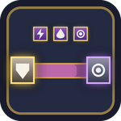
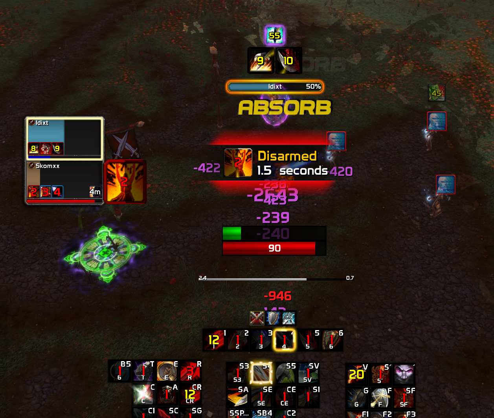
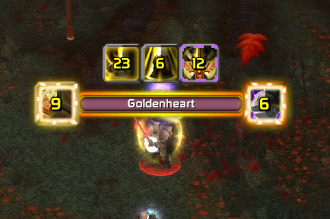
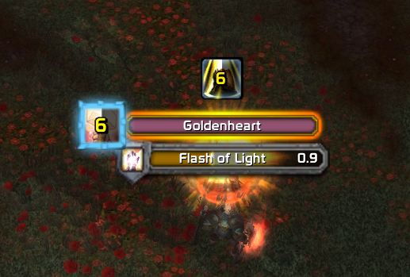
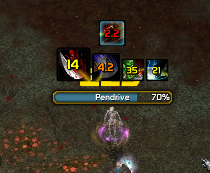

# SkomsPlateBuffs 1.0.0 (WoW 3.3.5a)

Enemy nameplate auras, laid out the way you decide: rows beside and above the nameplate, each showing the categories you pick, with glow and its own spell list. Built on the PlateBuffs engine (see Credits); the layout, categories, glow and options are new.

| | | |
|---|---|---|
|  |  |  |

## Rows
- **Left row** and **right row**: one row each, 3 icons by default.
- **Top row** above the plate, and **extra top rows** you add (up to five more). Each has its own number of icons and size.
- **Top row = My debuffs** (a switch on the row): your own debuffs on enemies, except hard crowd control (stuns, fears, silences, disarms, interrupts), which stays on the right row. Which ones, their size and their glow are set in the Spells tab, *My debuffs*. The list starts with your class's debuffs and grows with every debuff you apply.
- Every row picks what it shows:
  - categories: crowd control, disarms, roots, snares, healing reduction, interrupt lockouts, immunities, defensive, shields, offensive, speed boosts and other buffs;
  - **Any other aura**: everything no earlier row took.
- Per row: buffs and debuffs / debuffs only / buffs only, and **only my auras**.
- An aura goes to the first row that takes it. Rows set to *Only my auras* are checked first, then left, right and the top rows in order.

**Friendly nameplates** (Rows > Friendly nameplates): off by default, so friendly plates get the same rows as enemy ones. Tick *On friendly nameplates, show only a top row* and they get a single top row instead, with the categories you choose (crowd control, roots, interrupts and disarms by default), its own icon size, number of icons and glow. Friendly nameplates must be on in Display conditions > Unit reaction.

Default set-up (32 px icons, extra top row 28 px): left = buffs only: immunities, defensive and offensive cooldowns; right = debuffs only: crowd control, roots, interrupts, disarms, snares, healing reduction; top row = my debuffs; extra top row 1 = other buffs.

## Options (`/spb`)
- **Main settings:** Rows (per row: on/off, max icons, size, show, only mine, glow, categories), Display conditions, Appearance.
- **Position:** left/right and top offsets and spacing, test mode, glow showcase.
- **Spells:** a tree by category, like the BigDebuffs spells tab. Each category has its priority and glow and an add-by-ID box; each spell has show on/off, category, priority, icon size multiplier (for example Hamstring 1.5x) and its own glow; hovering a spell shows what it does. *My debuffs* is the first group.
- **Profiles** and **About**.

## Glow
Per category and per spell: none, border (optionally pulsing), pixel glow, autocast shine, action button glow, proc glow (the same styles as WeakAuras). The last four need `LibCustomGlow-1.0`, which comes with WeakAuras; without it they are drawn as the border.

Glow colour: the style's native yellow, by spell type, or by category (default). Border colour: by spell type, by category, or one custom (dark) colour. Magic buffs you can dispel get a glow of their own (Appearance > Glow). To compare the styles: Position > Glow showcase, or `/spb glow`.

## Install
1. Delete or disable the original **PlateBuffs** (two copies would draw on the same plates).
2. Put the `SkomsPlateBuffs` folder in `Interface\AddOns`.
3. Log in. Settings from the original PlateBuffs (`PB_DB`) are copied over once, to `SkomsPlateBuffsDB`.

No client patches are needed. Nameplates are found with LibNameplates, auras come from the combat log and from `UnitAura` on your target, focus and mouseover. A plate whose unit the addon cannot identify yet shows nothing until you target or mouse over it.

## Credits and inspirations
**Built on** (code this addon still runs on):
- **PlateBuffs** by **Cyprias**: nameplate tracking, icons, timers and the base of the options.
- 3.3.5a backport by **Kader**; WotLK changes and fixes by **Khal**: https://github.com/KhalGH/PlateBuffs-WoTLK

**Inspired by**:
- **MiniCC / MiniAuras** by **Verubato**: crowd control and important buffs beside the nameplate. No code copied.
- **BigDebuffs** by **Jordon** and **Tsoukie**: the starting spell category list, and the layout of the spells tab.
- **WeakAuras** and **LibCustomGlow-1.0**: the glow styles (pixel, autocast shine, action button, proc). Used if present.

**New in this addon** (by **Skom**): the rows system, the categories and their priorities, My debuffs, per-category and per-spell glow and size, dispellable-buff glow, the Spells tab, speed boosts, shields, snares, healing reduction, and the glow showcase.
