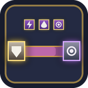
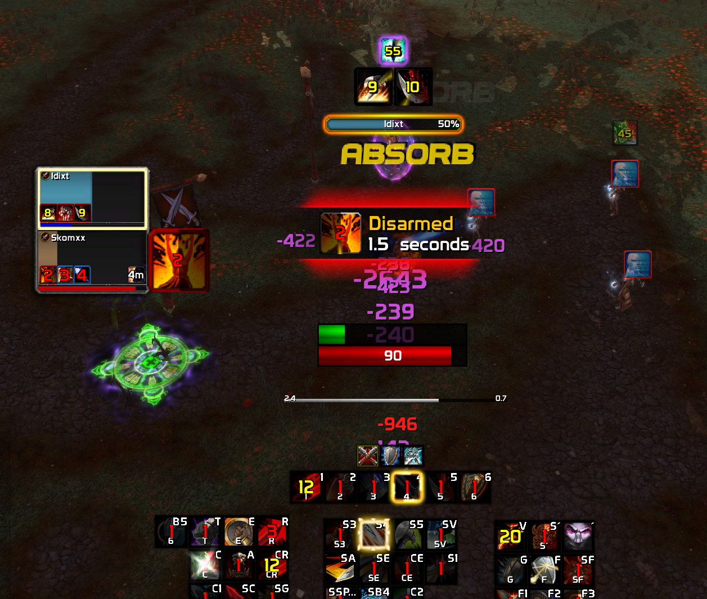
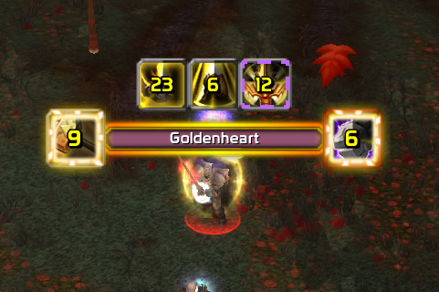
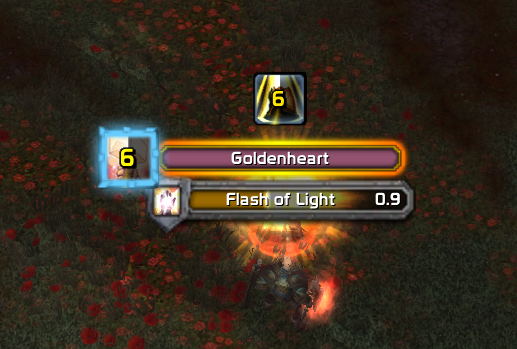
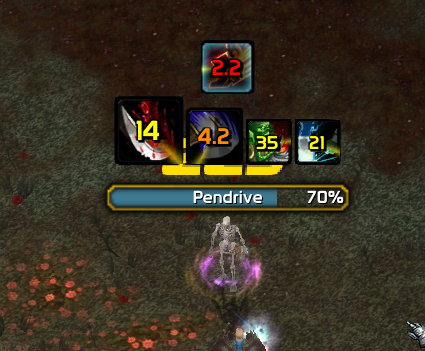

# Skom's Plate Buffs (WoW 3.3.5a)

See every crowd control, cooldown and debuff that matters right on enemy nameplates, laid out the way you want. Made for PvP.

| | | |
|---|---|---|
|  |  |  |

## Features

- **Rows around the nameplate:**
  - left, right, top and up to five extra top rows;
  - each with its own icon size, icon count and position;
  - each showing the categories you pick.
- **PvP categories:** crowd control, interrupts, roots, snares, disarms, healing reduction, immunities, defensives, offensives, shields and speed boosts.
- **My debuffs** on the top row, so you track your own DoTs and debuffs at a glance.
- **Glow and size** per category or per spell, in the WeakAuras glow styles. Dispellable magic buffs are highlighted.
- **Hundreds of spells** sorted and checked against the 3.3.5a client data:
  - search by name or ID;
  - add your own by ID;
  - set the priority of each one.
- **Friendly nameplates** can get their own single row of crowd control.
- **Test mode:** target any enemy to see sample auras in every row and place them without a fight.
- **Profiles** per character or shared.

The default layout puts:
- immunities and cooldowns on the left;
- crowd control and other debuffs on the right;
- your debuffs on top.

## Install

Disable the original **PlateBuffs** first. Your old settings are imported once.

## Commands

`/spb` opens the options, `/spb glow` shows every glow style.

## Feedback

- **GitHub:** https://github.com/Ahmedrn/SkomsPlateBuffs/issues
- **Warperia:** comment on the addon page
- **Discord:** `skomzx`

## Credits

Built on **PlateBuffs** by Cyprias, with the 3.3.5a backport by Kader and the WotLK fixes by Khal.
